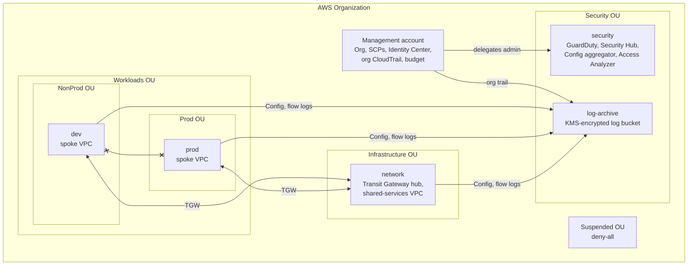

# AWS Multi-Account Landing Zone

A secure, multi-account AWS foundation built from scratch in Terraform. It sets up AWS Organizations with guardrails, single sign-on, centralized and tamper-resistant logging, org-wide threat detection, and a segmented hub-and-spoke network.

This is the structure companies put in place before they run real workloads on AWS. I built it without Control Tower so every piece is visible and explainable.

## Architecture



| Account | OU | Purpose |
|---|---|---|
| management | Root | Organizations, SCPs, Identity Center, org trail, budget. Kept empty of workloads because SCPs cannot restrict it. |
| log-archive | Security | Single destination for CloudTrail, Config, and VPC flow logs. Nobody works here day to day. |
| security | Security | Delegated admin for GuardDuty, Security Hub, Config, and IAM Access Analyzer. |
| network | Infrastructure | Owns the Transit Gateway and shared-services VPC. Shares the TGW with the org through RAM. |
| dev | Workloads / NonProd | Private spoke VPC. |
| prod | Workloads / Prod | Private spoke VPC. |

## What each layer does

The stack is split into layers with separate state files. Each layer reads the outputs it needs from earlier layers through remote state. This keeps the blast radius of any one apply small, and lets later layers use account IDs that do not exist until the accounts are created.

| Layer | Highlights |
|---|---|
| `00-bootstrap` | KMS-encrypted, versioned S3 state bucket with TLS-only policy and native S3 state locking. |
| `01-organization` | OU tree, five member accounts, four SCPs, centralized root access (no standing root credentials in member accounts), RAM sharing, monthly budget alerts. |
| `02-identity` | IAM Identity Center permission sets and groups. Access is granted to groups, never to individuals. No IAM users anywhere. |
| `03-logging` | Organization trail (all accounts, all regions, log file validation) into a KMS-encrypted bucket. Bucket and key policies are scoped with `aws:SourceArn` and `aws:SourceAccount` to prevent confused-deputy access. Logs cannot be deleted except by the break-glass role. |
| `04-security` | GuardDuty, Security Hub, and Config enabled in every account and administered from the security account. Org-wide IAM Access Analyzer flags anything shared outside the org. |
| `05-network` | Transit Gateway with two route tables. Dev and prod can reach shared services but not each other. VPCs have no internet gateway. Flow logs go to the log archive in Parquet. |

### Guardrails (SCPs)

| Policy | Attached to | What it stops |
|---|---|---|
| `baseline-guardrails` | Root | Leaving the org, root user actions, disabling CloudTrail/Config/GuardDuty/Security Hub, turning off default EBS encryption, modifying the break-glass role |
| `region-restrict` | Root | Any regional service outside the allowed regions (global services exempted) |
| `workload-guardrails` | Workloads OU | IAM users and access keys, internet gateways, VPC peering, recreating default VPCs |
| `deny-all` | Suspended OU | Everything, for accounts being decommissioned |

Guardrails that would block Terraform itself exempt one principal: `OrganizationAccountAccessRole`, which only the management account can assume and which the baseline SCP protects from modification.

### Access model (Identity Center)

| Group | Permission set | Accounts |
|---|---|---|
| platform-admins | PlatformAdmin (1 hour sessions) | All |
| security-auditors | SecurityAudit | All |
| developers | Developer (PowerUser, no org or network changes) | dev |
| developers | ReadOnly | prod |

## Deploying

### Prerequisites

- A fresh AWS account to act as the management account, with MFA on the root user. Do not use an account that already runs other things.
- Terraform 1.10 or newer (or OpenTofu 1.10+ with `TF=tofu`) and AWS CLI v2.
- Credentials for an administrator in that account.
- Five unused email addresses. Plus-addressing (`you+lz-dev@gmail.com`) works.

### Steps

```bash
# 1. State bucket (local state, run once)
cd layers/00-bootstrap
terraform init && terraform apply
terraform output -raw backend_hcl > ../../backend.hcl
cd ../..

# 2. Fill in variables
for d in layers/0[1-2]-*; do cp "$d/terraform.tfvars.example" "$d/terraform.tfvars"; done
#    edit layers/01-organization/terraform.tfvars (account emails, budget email)
#    edit layers/02-identity/terraform.tfvars (your Identity Center user)

# 3. Organization and accounts
./scripts/deploy.sh 01-organization

# 4. In the console: IAM Identity Center > Enable (organization instance, same region)

# 5. Identity, logging, security
./scripts/deploy.sh 02-identity 03-logging 04-security

# 6. Network (starts Transit Gateway billing, see Cost)
./scripts/deploy.sh 05-network
```

The deploy script reads the state bucket from `backend.hcl`, so layers 02 to 05 need no extra variables unless you change defaults.

If account creation fails with a quota error, request a higher "Default maximum number of accounts" in Service Quotas. Brand-new organizations can start with a low limit.

## Verifying it works

Sign in through the Identity Center access portal, set up CLI profiles with `aws configure sso`, then run:

```bash
./scripts/verify-guardrails.sh --profile lz-dev-admin --network-profile lz-network-admin
```

It tries things the guardrails should block, using an admin role in the dev account, because SCPs must stop even an administrator. Every test is a dry run, read-only, or undone immediately if it unexpectedly succeeds.

```
Workload guardrails (Workloads OU)
  PASS  IAM user creation is denied
  PASS  Internet gateway creation is denied
  PASS  VPC peering is denied

Baseline guardrails (whole org)
  PASS  Region eu-west-1 is denied
  PASS  AWS Config recorder cannot be stopped
  PASS  GuardDuty cannot be disabled
  PASS  OrganizationAccountAccessRole cannot be modified

Network segmentation (Transit Gateway)
  PASS  Spokes can reach shared services (10.0.0.0/16)
  PASS  Dev has no route to prod (10.20.0.0/16)
```

Other things worth checking by hand:

- **Security Hub** in the security account lists findings from every account.
- **Config aggregator** in the security account shows resources from all six accounts.
- **Log archive bucket** has `cloudtrail/`, `config/`, and `vpc-flow-logs/` prefixes, and `aws s3 rm` on any log object fails even as an account admin.
- **CloudTrail** in a member account shows the org trail and does not allow stopping it.

## Cost

Approximate, us-east-1, for a quiet lab.

| Item | Cost |
|---|---|
| Organizations, SCPs, Identity Center, Access Analyzer (external access), budget | Free |
| KMS keys (state and logs) | About $2/month |
| CloudTrail organization trail (first copy of management events) | Free; S3 storage is pennies |
| GuardDuty and Security Hub | 30-day free trial, then usage-based. Both consoles show a projected monthly cost during the trial. |
| AWS Config | $0.003 per configuration item recorded, plus Security Hub control evaluations at $0.001 each. Small for idle accounts. |
| **Transit Gateway** | **3 attachments x $0.05/hour = about $3.60/day (about $108/month)** |

The Transit Gateway is the only meaningful cost. Apply `05-network` when you want to demo or test, then destroy it. The monthly budget alert in layer 01 is the backstop.

## Teardown

```bash
./scripts/destroy.sh         # destroys 05 through 02: everything that costs money
./scripts/destroy.sh --all   # also destroys 01 and closes the member accounts
```

Leaving layer 01 in place is the normal choice. The org, OUs, SCPs, and empty accounts cost nothing. Closing accounts has side effects: closed accounts stay suspended for 90 days, their emails cannot be reused, only a small share of accounts can be closed per 30 days, and the org cannot be deleted until the suspended accounts age out.

## Known gaps and next steps

Being upfront about what this does not do yet:

- **Default VPCs.** Accounts created through Organizations get a default VPC (with an internet gateway) in every region. The SCPs block other regions and block recreating them, but the existing ones in the home region should be deleted.
- **Single region.** GuardDuty, Security Hub, and Config are regional. A multi-region version would add a provider per region or use Security Hub central configuration.
- **No centralized egress yet.** The next step is a NAT gateway and AWS Network Firewall in the network account, with a default route from the spokes through the hub.
- **Identity Center is administered from the management account.** Delegating it to a separate account would reduce how often anyone touches the management account.
- **Resource control policies.** RCPs would add a data perimeter, for example denying access to org S3 buckets from outside the org.
- **CI runs checks but not plans.** Adding GitHub OIDC with a read-only role would let pull requests show a real `terraform plan`.

## Repository layout

```
layers/
  00-bootstrap/       state bucket
  01-organization/    org, OUs, accounts, SCPs, budget
  02-identity/        Identity Center
  03-logging/         org trail, log archive bucket, KMS
  04-security/        GuardDuty, Security Hub, Config, Access Analyzer
  05-network/         Transit Gateway hub and spoke VPCs
modules/
  config-recorder/    Config recorder for one account
  spoke-vpc/          private VPC attached to the TGW
policies/scp/         SCP documents (JSON templates)
scripts/              deploy, destroy, verify-guardrails
docs/                 design decisions, interview talking points
```

CI (`.github/workflows/ci.yml`) runs `terraform fmt`, `terraform validate` on every layer and module, `tflint` with the AWS ruleset, and `checkov`. Every checkov skip is documented next to the resource it applies to.

See [docs/design-decisions.md](docs/design-decisions.md) for why things are built the way they are.
